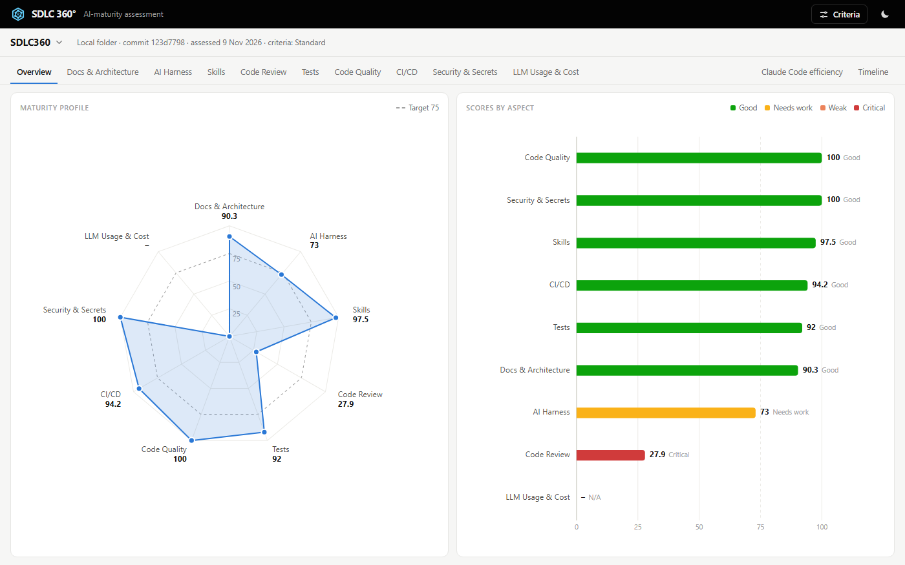

# SDLC360

Checks how a git repository (GitHub or local) is run: docs, AI harness, skills, code review, tests, code quality,
CI/CD, security, LLM cost. Every verdict shows its evidence. No LLM, stdlib-only Python 3.12.

## Your journey

1. **Start the app:** `./start.sh --open` (http://127.0.0.1:8360/, `./stop.sh` stops it).
2. **Choose the reference projects:** **Criteria** → **Overview** lists well-run repositories; add your own.
3. **Calibrate the rules:** the refresh button, then tune the rules that misfire on the reference set and save a profile.
4. **Assess your project:** **Open a project**, paste a GitHub URL or pick a local folder, press **Assess**.
5. **Fix and re-assess:** each capability says what was expected, what was found and what to do.

More: [usage](docs/usage.md), [calibration](docs/calibration.md), [architecture](docs/architecture.md),
[references](assessment/references/README.md), [AGENTS.md](AGENTS.md).

