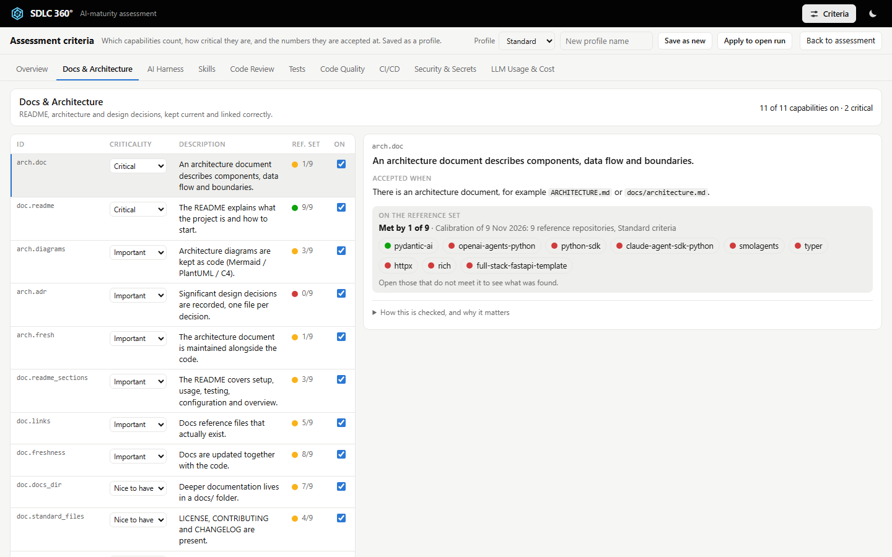
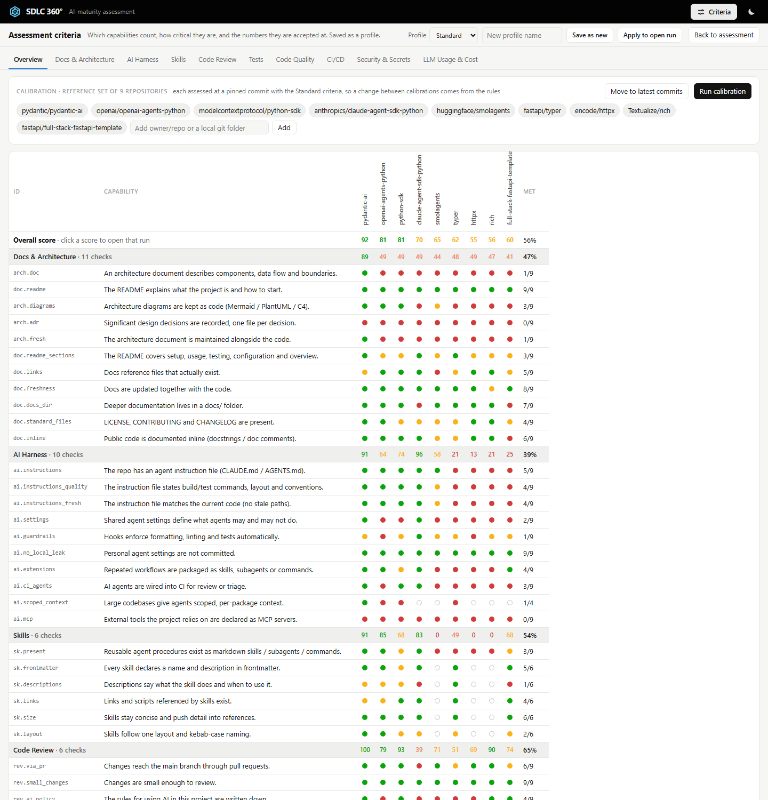
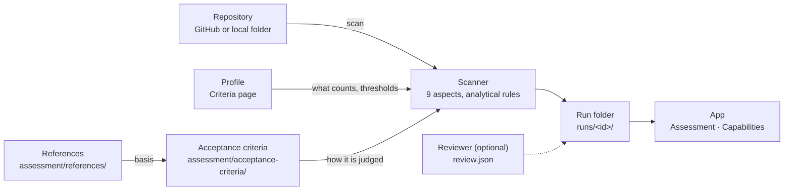

# SDLC360: a 360° check-up of any software repository

Point SDLC360 at a GitHub repository or a local git folder. A minute later you see, aspect by aspect, whether the
project is run the way a modern, AI-assisted team should run it: what is in place, what is missing, and what to fix
first.

It answers questions like:

- **Can a coding agent work in this repo safely and productively?** Are there instructions, permissions, guardrails, skills?
- **Would a new engineer find their way?** Is the README current, is the architecture written down, do the docs match the code?
- **Will a change break something unnoticed?** Are there tests, do they run on every pull request, is coverage enforced?
- **Is anything leaking or drifting?** Secrets, credential files, unpinned dependencies, unbounded LLM spend.


## What makes it trustworthy

- **Every verdict shows its evidence.** For each capability you see what we expected, what we found (file and line,
  linked to the exact commit), the verdict, how it was checked and what the check cannot see.
- **No guessing, no LLM.** The checks are analytical rules over the files and git history of one commit. The same
  commit always gets the same verdicts, and every scan is kept as a reproducible run.
- **Capabilities are not our invention.** Each one cites published guidance verbatim: Google's *New SDLC* and DORA's
  research on AI-assisted delivery, NIST's secure development framework, OWASP's agentic risks, OpenSSF Scorecard,
  Anthropic's agent guidance and the AGENTS.md and Agent Skills standards. The few that rest on our own judgement
  say so. See [the references](assessment/references/README.md).
- **Calibrated on well-run open-source projects.** Nine reference repositories are assessed at pinned commits, and
  the Criteria page shows how every rule does on them (for example, `pydantic/pydantic-ai` scores 92, A). Each false
  alarm found on them became a fix and a regression test ([calibration](docs/calibration.md)).

## What it looks at

Nine aspects of equal weight.

| Aspect | The question |
|---|---|
| Docs & Architecture | Can a newcomer, human or agent, start from the README; are components and key decisions written down and current? |
| AI Harness | Do coding agents get instructions, permissions and automatic guardrails? |
| Skills | Are repeated agent workflows packaged as well-formed, discoverable skills? |
| Code Review | Do changes reach the main branch through pull requests, stay small, and is the use of AI governed? |
| Tests | Is there a test suite, does it grow with the code, is coverage measured and enforced? |
| Code Quality | Linting, formatting, type checking, pre-commit hooks and code structure |
| CI/CD | Are pull requests gated, is setup one command with pinned toolchains, are releases automated? |
| Security & Secrets | No committed secrets; locked and updated dependencies, scanning, least-privilege CI |
| LLM Usage & Cost | Are LLM tokens tracked and capped? (not applicable when the code calls no LLM) |

Each aspect is a checklist of capabilities with a priority: **critical**, **important** or **nice to have**.
An unmet critical capability caps its aspect at 49 out of 100, whatever else passes.

## Your journey

Six steps, all in the browser.

<details><summary><b>1 · Start the app</b></summary>

```bash
./start.sh --open      # opens http://127.0.0.1:8360/ ; ./stop.sh stops it
```

Requirements: Python 3.12+ and git. Nothing to install: the tool uses only the Python standard library.
</details>

<details><summary><b>2 · Choose a project and assess it</b></summary>

Click the project name under the black bar (or **Open a project**): it lists the assessed projects. Paste a GitHub
URL or `owner/repo`, or pick a local git folder with the folder picker, choose a profile and press **Assess**. Local
folders are only read, never changed.
</details>

<details><summary><b>3 · Read the assessment</b></summary>

The **Overview** shows every aspect at once: a maturity radar and the score of each aspect. Each aspect is a list of
capabilities with their status. Click one to see what was **expected**, what we **found** and
**what to do**. When it is accepted, how it is checked and why it matters are folded away below.


</details>

<details><summary><b>4 · Make it yours</b></summary>

The **Criteria** page (button at the top right) has the same layout. Switch capabilities on or off, set how critical
each one is, change the numbers in **Accepted when** ("There are at least **5** test files"), and add capabilities of
your own in plain words. Save it as a profile; **Apply to open run** re-judges the open assessment at once.

The column **Ref. set** and the block *On the reference set* show how each rule does on the reference repositories.
The **Overview** of the Criteria page holds the calibration: the reference set (add your own), **Run calibration**,
and a matrix of every check on every reference repository. Click a rule to open it, a dot to open that run.




</details>

<details><summary><b>5 · See how the agent is used</b> (local projects)</summary>

**Agent use**, the last tab, reads the coding agent's session logs on this machine (Claude Code, read only) and the
git history: hours, commits, cost at API prices, and findings with an example from the project, why it matters and
what to do, for business, team lead or developer. Prompts and answers are never shown. Prototype.
</details>

<details><summary><b>6 · Fix and re-assess</b></summary>

After changes, press **Re-assess**. The new run appears next to the earlier ones, so progress is visible.
</details>

## Where things live

| You want to change | Where |
|---|---|
| **Which capabilities count**, how critical each is, and the numbers they are accepted at | the **Criteria** page: a profile (*Standard*, *Prototype*, or your own) |
| **A capability of your own** that no rule checks | **Criteria** → *Add your own capability*, with when it is accepted; a reviewer records the verdict ([review.json](docs/reviewer-verdicts.md)) |
| **How a rule checks**, its blind spots and published basis (for developers) | [`assessment/acceptance-criteria/`](assessment/acceptance-criteria/), one file per aspect |
| **Why we expect it** | [`assessment/references/`](assessment/references/README.md) |

Profiles are saved in [`assessment/profiles/`](assessment/profiles/). From the command line:
`python sdlc.py scan <target> --profile prototype`, `python sdlc.py render runs/<run-id> --profile <name>`.

## How it works



## For developers

- Setup, command line, run folders, configuration and testing: [docs/usage.md](docs/usage.md).
- Architecture and design decisions: [docs/architecture.md](docs/architecture.md), [docs/design-decisions/](docs/design-decisions/).
- Contributing: [.github/CONTRIBUTING.md](.github/CONTRIBUTING.md). Coding agents follow [AGENTS.md](AGENTS.md).
- Tests: `.venv/Scripts/python -m pytest --cov` (unit and integration, run in CI on Linux and Windows).
- Configuration: `.env` (template `.env.example`) is for maintainers only; a scan needs no secrets.
