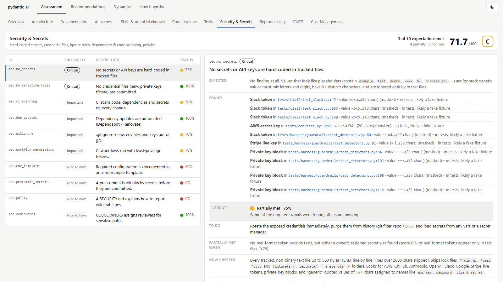
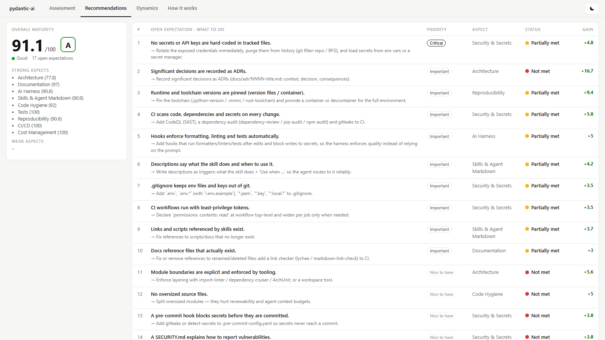
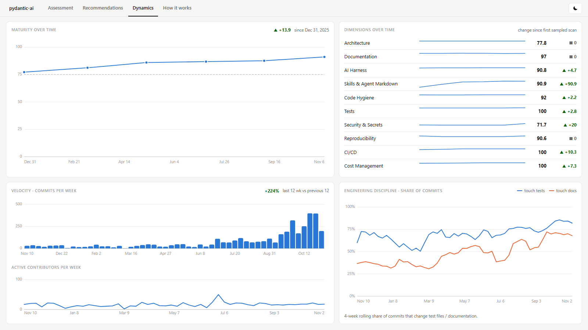
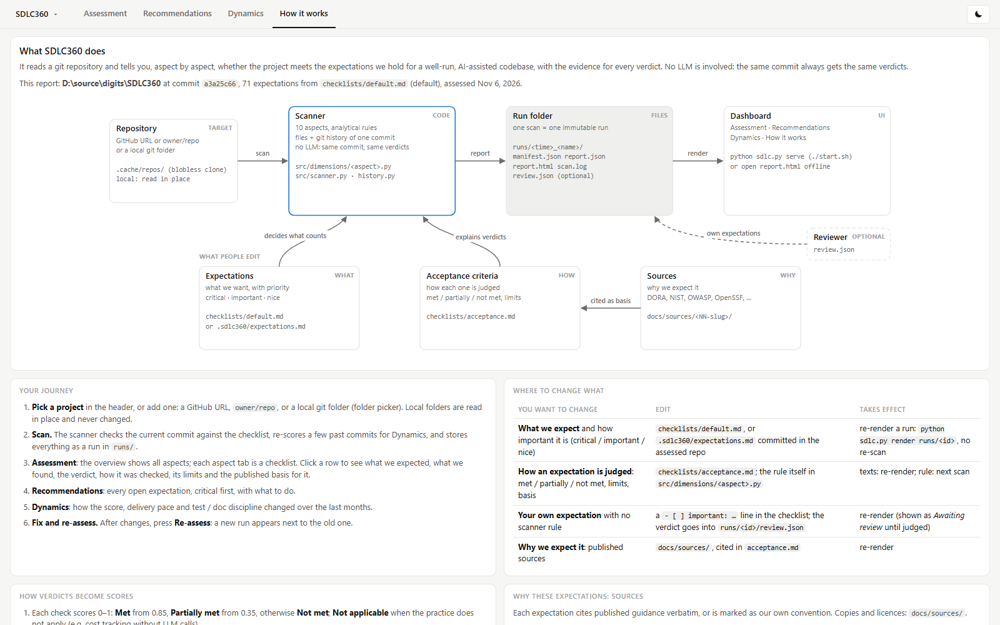
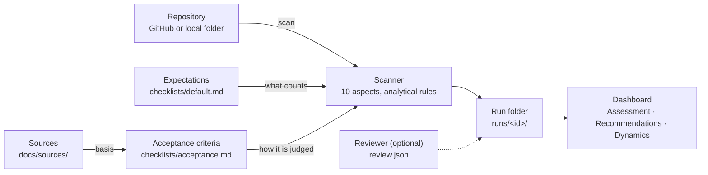

# SDLC360: a 360° check-up of any software repository

Point SDLC360 at a GitHub repository or a local git folder. A minute later you see, aspect by aspect, whether the
project is run the way a modern, AI-assisted team should run it: what is in place, what is missing, what to fix
first, and how the project has been moving over the last year.

It answers questions like:

- **Can a coding agent work in this repo safely and productively?** Are there instructions, permissions, guardrails, skills?
- **Would a new engineer find their way?** Is the README current, is the architecture written down, do the docs match the code?
- **Will a change break something unnoticed?** Are there tests, do they run on every pull request, is coverage enforced?
- **Is anything leaking or drifting?** Secrets, credential files, unpinned dependencies, unbounded LLM spend.


## What makes it trustworthy

- **Every verdict shows its evidence.** For each expectation you see what we expected, what we found (file and line,
  linked to the exact commit), the verdict, how it was checked and what the check cannot see.
- **No guessing, no LLM.** The checks are analytical rules over the files and git history of one commit. The same
  commit always gets the same verdicts, and every scan is kept as a reproducible run.
- **Expectations are not our invention.** Each one cites published guidance verbatim: Google's *New SDLC* and DORA's
  research on AI-assisted delivery, NIST's secure development framework, OWASP's agentic risks, OpenSSF Scorecard,
  Anthropic's agent guidance and the AGENTS.md and Agent Skills standards. The few that rest on our own judgement
  say so. See [the sources](docs/sources/README.md).
- **Calibrated on well-run open-source projects.** For example, `pydantic/pydantic-ai` scores 91 (A). Each false
  alarm found on such projects became a fix and a regression test ([calibration](docs/calibration.md)).

## What it looks at

Ten aspects, in the order a project is built: design, build, verify, deliver, operate.

| Aspect | The question |
|---|---|
| Architecture | Are the components, data flow and key decisions written down and current? |
| Documentation | Can a newcomer, human or agent, start from the README, and do the docs match the code? |
| AI Harness | Do coding agents get instructions, permissions and automatic guardrails? |
| Skills | Are repeated agent workflows packaged as well-formed, discoverable skills? |
| Code Hygiene | Linting, formatting, type checking and pre-commit hooks |
| Tests | Is there a test suite, does it grow with the code, is coverage measured and enforced? |
| Security | No committed secrets or credential files; scanning, dependency updates, least-privilege CI |
| Reproducibility | Locked dependencies, pinned toolchains, one-command setup, documented reproduction |
| CI/CD | Are pull requests gated, releases automated, workflows pinned, fast and bounded? |
| Cost | Are LLM tokens and cloud spend tracked and capped? (not applicable when there are none) |

Each aspect is a checklist of expectations with a priority: **critical**, **important** or **nice to have**.
An unmet critical expectation caps its aspect at 49 out of 100, whatever else passes.

## Your journey

Six steps, all in the browser.

<details><summary><b>1 · Start the app</b></summary>

```bash
./start.sh --open      # opens http://127.0.0.1:8360/ ; ./stop.sh stops it
```

Requirements: Python 3.12+ and git. Nothing to install: the tool uses only the Python standard library.
</details>

<details><summary><b>2 · Choose a project and scan it</b></summary>

Click the project name in the header. Paste a GitHub URL or `owner/repo`, or pick a local git folder with the folder
picker. **Scan** checks the current commit, re-scores a few past commits for the Dynamics view and stores the run.
Local folders are only read, never changed.
</details>

<details><summary><b>3 · Read the assessment</b></summary>

The **Overview** shows all aspects at once. Each aspect tab is a checklist: ID, criticality, the expectation and
its status. Click a row to see what we expected, what we found, the verdict, how it was checked, its limits and the
published basis for it.


</details>

<details><summary><b>4 · Decide what to fix</b></summary>

**Recommendations** lists every open expectation across all aspects, critical first, with what to do.


</details>

<details><summary><b>5 · See how the project evolves</b></summary>

**Dynamics** shows the score over the last months, delivery pace, active contributors, and how often commits
touch tests and documentation.


</details>

<details><summary><b>6 · Fix and re-assess</b></summary>

After changes, press **Re-assess**. The new run appears next to the earlier ones, so progress is visible.
</details>

## Make it yours

The tab **How it works** in the app explains the same on one page.



| You want to change | Edit |
|---|---|
| **What we expect** and how important it is | [`checklists/default.md`](checklists/default.md), or commit `.sdlc360/expectations.md` to the assessed repository |
| **How an expectation is judged**: met / partially / not met, limits, basis | [`checklists/acceptance.md`](checklists/acceptance.md) |
| **An expectation of your own** that no rule checks | add `- [ ] important: …` to the checklist; a reviewer records the verdict ([review.json](docs/review.md)) |
| **Why we expect it** | [`docs/sources/`](docs/sources/README.md) |

A changed checklist or acceptance text is applied to an existing run without re-scanning:
`python sdlc.py render runs/<run-id>`.

## How it works



## For developers

- Setup, command line, run folders, configuration and testing: [docs/usage.md](docs/usage.md).
- Architecture and design decisions: [docs/architecture.md](docs/architecture.md), [docs/adr/](docs/adr/).
- Contributing: [CONTRIBUTING.md](CONTRIBUTING.md). Coding agents follow [AGENTS.md](AGENTS.md).
- Tests: `.venv/Scripts/python -m pytest --cov` (unit and integration, run in CI on Linux and Windows).
- Configuration: `.env` (template `.env.example`) is for maintainers only; a scan needs no secrets.
