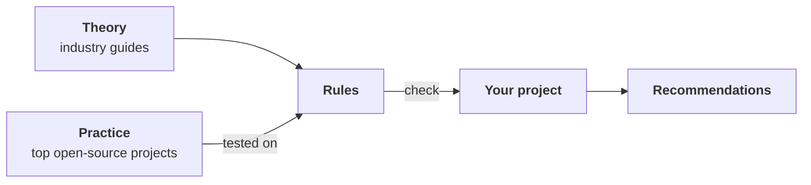
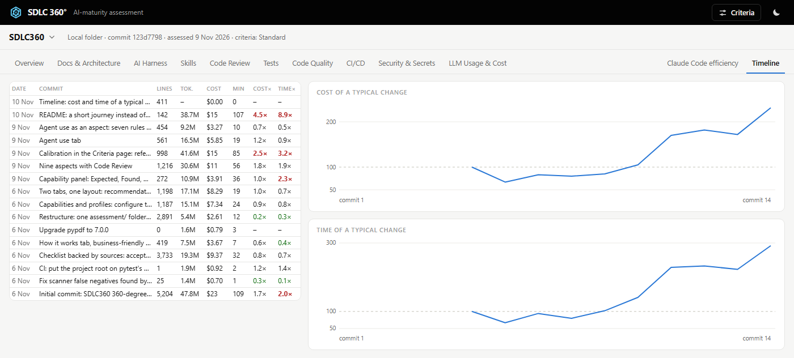

# SDLC360

**Assess your AI-agent readiness.**

- **360° feedback** on docs and architecture, AI harness, skills, code review, tests, code quality, CI/CD,
  security and secrets, LLM usage and cost.
- **Recommendations.** For every gap: what was expected, what was found and the next step to fix it.
- **Agent efficiency over time.** The cost (tokens, $) and time (minutes) of a typical change by Claude Code,
  commit by commit, adjusted for change size: see if your project gets easier or harder for the agent.

## How it works

Rules are taken from industry guides, tested on top open-source projects, and then run on your repository.

### Theory

- **Anthropic:** Claude Code best practices, context engineering for AI agents
- **OpenAI:** harness engineering, AGENTS.md
- **Google / DORA:** the new SDLC with AI agents, State of AI-assisted Software Development 2025
- **Security:** NIST SSDF for generative AI, OWASP Top 10 for Agentic Applications, OpenSSF Scorecard

### Practice

- **Agent frameworks and SDKs:** Pydantic AI, OpenAI Agents SDK, MCP Python SDK, Claude Agent SDK, smolagents
- **Mature libraries:** httpx, Rich, Typer, Full Stack FastAPI Template

If a strong project fails a rule, we fix the rule.

## 360-degree view of your project

The score in docs and architecture, AI harness, skills, code review, tests, code quality, CI/CD, security and
secrets, LLM usage and cost.

## Your AI agent over time

Cost and time of a typical change, commit by commit. 100 is where you started; above 100, changes cost more.

