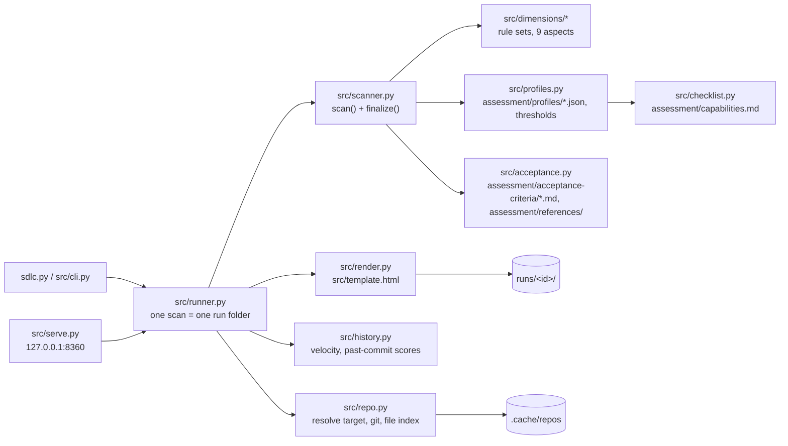
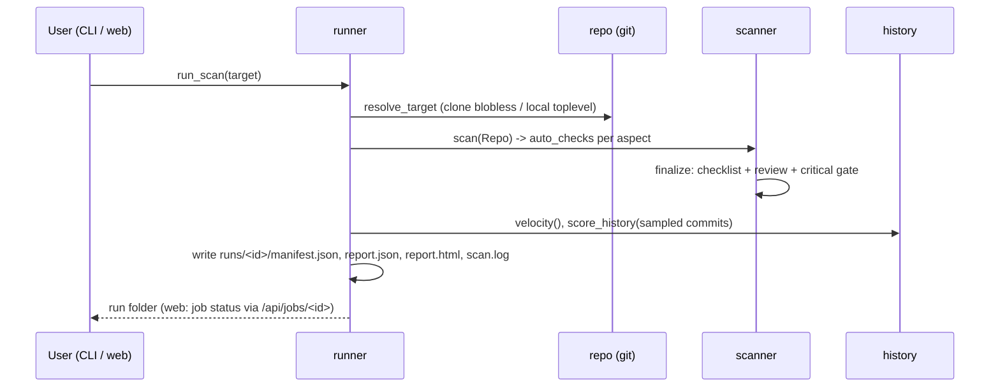

# Architecture

SDLC360 is a single-process Python tool (standard library only). It has two front ends, the CLI and a local web
app, over one core: **resolve → scan → finalize → write run**.

## Components

| Component | Responsibility | Boundary |
|---|---|---|
| `repo.py` | Validate and resolve a target, then index files (`git ls-files` plus untracked files on disk) | The only module that runs git on the target. Read-only for local repos |
| `dimensions/*` | Scanner rules in topic modules: `assess(repo) -> [Check]` with score 0..1 or `None` (N/A), evidence and recommendation. `__init__.py` lists the nine aspects; a check's aspect is its section in `capabilities.md` | Pure functions of `Repo`. No I/O besides reading git and files |
| `checklist.py` | Parse the capability catalog: ids, standard priorities, custom items | No knowledge of scanners |
| `profiles.py` | Profiles (overrides of the catalog) and `PARAMS`, the adjustable thresholds; validation on save | Writes only `assessment/profiles/<id>.json`; `standard` is read-only |
| `scanner.py` | `scan()` runs all aspects and keeps raw `auto_checks`. `finalize()` applies checklist, review and the critical gate | `finalize()` is idempotent and needs no repo |
| `history.py` | Weekly velocity, and re-scoring of sampled past commits in temporary worktrees or shared clones | Never writes into a user's `.git` |
| `runner.py` | Orchestrates a scan and writes `manifest.json`, `report.json`, `report.html` and `scan.log` | Owns the run-folder contract |
| `agent_usage.py` | The Agent use tab of a local project: Claude Code session logs read in place, joined with `git log`; seven rules shown like an aspect | Reads logs read-only and shows numbers, never prompt text |
| `calibration.py` | Reference set (`assessment/calibration/`), one calibration = one run per repository plus a snapshot of every verdict in `runs/calibrations/<id>.json`, comparison with the previous snapshot | Records and counts verdicts, judges nothing |
| `serve.py` | JSON API plus app page. One scan or calibration at a time. Read-only folder browser. Saves profiles, applies one to a run, edits the user's reference repositories | Binds to 127.0.0.1 and rejects foreign `Host` / `Origin` |
| `template.html` | The whole UI. Static mode embeds a report, app mode fetches from the API | Renders only; no scoring logic |

## Data flow of a scan

## Scoring

- A check's score `s ∈ [0, 1]` maps to a verdict: Met (s ≥ 0.85), Partially met (s ≥ 0.35), Not met, or N/A.
- An aspect score is the priority-weighted mean of its applicable capabilities (critical 5, important 3, nice 1),
  plus an optional reviewer adjustment of ±20.
- **Critical gate**: an unmet critical capability caps the aspect at 49; a partially met one caps it at 74.
- Overall = the unweighted mean of the aspects that apply (not N/A).

The report keeps raw scanner output (`auto_checks`) separate from final `checks`. A changed checklist or a new
`review.json` is applied with `python sdlc.py render <run>`, without re-scanning.

## Known limitations

- Most checks are presence and structure heuristics. They can be satisfied by empty files, so a green verdict means
  "the practice is visible", not "the practice is good".
- The secret scan covers HEAD only, not the history.
- Historical points (`--history`) are scored with the rules of the tool version that produced the run.

Decisions behind this design: [design-decisions/](design-decisions/).
